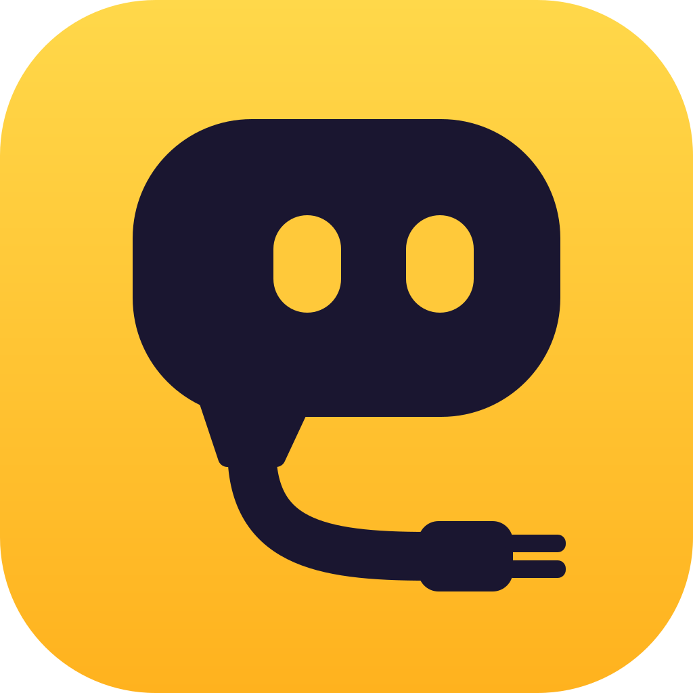
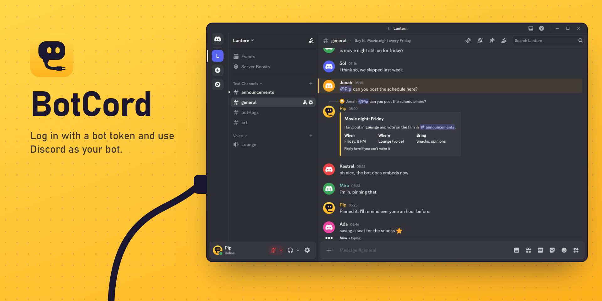

<div align="center">



# BotCord

Log in to Discord with a bot token and use the bot like a normal account.

[](https://github.com/pealz1/BotCord/releases/latest)
[](https://github.com/pealz1/BotCord/releases)
[](LICENSE)

</div>



BotCord is a desktop Discord client for bot accounts. It runs Discord's real web client, signed in as your bot, so you can read channels, send messages and embeds, manage servers and join voice as the bot without writing code. Useful for moderating through a bot, testing one, or just seeing what it sees.

It's a fork of [DiscordBotClient](https://github.com/aiko-chan-ai/DiscordBotClient) by aiko-chan-ai, with its own fixes and release builds. It was called BotDeck until 1.1.0. Runs on Windows, macOS and Linux.

> [!WARNING]
> This is a third-party client. Discord discourages them and they may break the [Terms of Service](https://discord.com/terms), so use it at your own risk. BotCord isn't affiliated with Discord.

## Download

| | |
| --- | --- |
| Windows 10/11 | [BotCord-win-x64.exe](https://github.com/pealz1/BotCord/releases/latest/download/BotCord-win-x64.exe) |
| macOS (Apple silicon) | [BotCord-mac-arm64.dmg](https://github.com/pealz1/BotCord/releases/latest/download/BotCord-mac-arm64.dmg) |
| macOS (Intel) | [BotCord-mac-x64.dmg](https://github.com/pealz1/BotCord/releases/latest/download/BotCord-mac-x64.dmg) |
| Linux | [BotCord-linux-x86_64.AppImage](https://github.com/pealz1/BotCord/releases/latest/download/BotCord-linux-x86_64.AppImage) |

Windows and Linux update themselves. On a Mac, get new versions from [Releases](https://github.com/pealz1/BotCord/releases/latest).

The builds aren't code-signed, so you'll get a warning the first time. On Windows, click **More info** and then **Run anyway**. On macOS, if it says the app is damaged, move it to Applications and run `xattr -cr /Applications/BotCord.app`. On Linux, `chmod +x` the AppImage.

Only download it from this repo. A modified copy could steal your token.

Coming from BotDeck? It updates itself to BotCord and keeps your logins. On a Mac, install BotCord and delete BotDeck.app.

## Getting started

1. In the [Developer Portal](https://discord.com/developers/applications), open your application's **Bot** page.
2. Turn on **Message Content Intent**. Turn on **Server Members** and **Presence** too if you want the member list with statuses.
3. Click **Reset Token**, copy it, and paste it into BotCord. Resetting signs out anything else using the old token, so update wherever your bot is hosted.

Your token only goes to Discord. BotCord's local server listens on 127.0.0.1 and checks the token with Discord before handing out any account data.

## What it can do

- Send, edit, reply to, react to, pin and delete messages, run polls, scroll through history
- Build embeds and Components V2 messages in a visual editor based on [Discohook](https://github.com/discohook/discohook), or the older built-in Embed Builder
- Manage servers, channels, roles and members, as far as the bot's permissions go
- Keep the DMs your bot opens or receives between sessions
- Talk in voice channels
- Sort the member list by name, using whatever intents the bot has
- Handle sharded bots: `/switch shard <id>` changes shard, `/switch guild <id>` jumps to any server the bot is in
- Save several bots, each with its own notification settings
- Use [Vencord](https://github.com/Vendicated/Vencord) plugins and themes
- Set a proxy or DNS over HTTPS (tray icon > Settings)

Bots can't have friends or group DMs, join servers through invites, create servers, stream or use a camera, so BotCord can't either. Uploads top out at 20 MB and messages at 2,000 characters.

Under the hood it's Vencord with a plugin that patches the client for bot accounts, plus a small local server. That server answers the user-only API calls a bot can't make (profile, settings, billing), blocks things like account deletion, and passes everything else to Discord as ordinary bot API requests.

## Troubleshooting

**Channels look empty.** Turn on Message Content Intent and log in again. If it's just one channel, the bot's role is probably missing View Channel or Read Message History there.

**The bot can't DM someone.** Discord blocks it when the person has turned off DMs from server members, or shares no server with the bot (error 50007).

**It's stuck on a gray screen.** That's nearly always a network problem. Try a VPN, or switch DNS over HTTPS to another provider in Settings. If that doesn't fix it, [open an issue](https://github.com/pealz1/BotCord/issues/new/choose) and attach the log from `%APPDATA%\BotCord\logs` (Windows), `~/Library/Logs/BotCord` (macOS) or `~/.config/BotCord/logs` (Linux), with your token removed.

**My antivirus flags it.** Unsigned Electron apps sometimes trip false positives. The releases are built by [GitHub Actions](https://github.com/pealz1/BotCord/actions/workflows/build.yml) straight from this repo, or you can build it yourself.

**Is this a selfbot?** No. Selfbots automate user accounts, which Discord bans. This is the opposite: you drive a bot account by hand.

Zoom with `Ctrl` + `=`, `Ctrl` + `-` and `Ctrl` + `0` (`Cmd` on a Mac).

## Building it yourself

You need Node.js 24 and Git.

```sh
git clone https://github.com/pealz1/BotCord.git
cd BotCord
npm run requirement   # dependencies, plus the pinned Vencord and Discohook checkouts
npm run build         # the installer ends up in dist/
```

To run it from source, use `npm run build:deps && npm run build:ts`, then `npm start`. [CONTRIBUTING.md](CONTRIBUTING.md) covers the project layout, tests and releases.

Bugs and ideas go in [Issues](https://github.com/pealz1/BotCord/issues/new/choose) or [Discussions](https://github.com/pealz1/BotCord/discussions). Report security problems privately, as described in [SECURITY.md](SECURITY.md).

## Credits

Most of this code is [aiko-chan-ai](https://github.com/aiko-chan-ai)'s work, from [DiscordBotClient](https://github.com/aiko-chan-ai/DiscordBotClient) and [VencordDBCPlugin](https://github.com/aiko-chan-ai/VencordDBCPlugin). If BotCord is useful to you, consider [sponsoring them](https://github.com/sponsors/aiko-chan-ai). Thanks also to:
- [ChrisEric](https://github.com/CE1CECL), for the local proxy approach;
- [SamuelScheit](https://github.com/SamuelScheit), whose [discord-bot-client](https://github.com/SamuelScheit/discord-bot-client) started the idea;
- the [Vencord](https://github.com/Vendicated/Vencord), [Vesktop](https://github.com/Vencord/Vesktop) and [Discohook](https://github.com/discohook/discohook) developers;
- everyone in the [contributor history](https://github.com/pealz1/BotCord/graphs/contributors).

BotCord bundles Vencord (GPL-3.0) and aiko-chan-ai's [Discohook fork](https://github.com/aiko-chan-ai/discohook) (AGPL-3.0-or-later), at the revisions pinned in [`scripts/build-dependencies.json`](scripts/build-dependencies.json). Electron and the npm packages keep their own licenses.

## License

[GPL-3.0](LICENSE), the same as DiscordBotClient. Discord is a trademark of Discord Inc.
