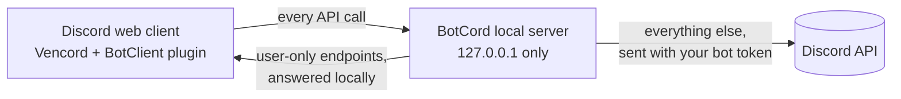

<div align="center">


# BotCord

**The desktop Discord bot client.** Log in to Discord with a bot token and use your bot like a normal account: read and send messages, manage servers, join voice, and build embeds, all in the real Discord interface.

[](https://github.com/pealz1/BotCord/releases/latest)
[](https://github.com/pealz1/BotCord/releases)
[](https://github.com/pealz1/BotCord/actions/workflows/build.yml)
[](LICENSE)
[](#download)

[Download](#download) · [Quick start](#quick-start) · [Features](#features) · [FAQ](#faq) · [Contributing](CONTRIBUTING.md) · [Report a bug](https://github.com/pealz1/BotCord/issues/new/choose)

</div>


> [!WARNING]
> BotCord is a third-party client. Third-party clients are discouraged by Discord and may be against the [Discord Terms of Service](https://discord.com/terms). Use it at your own risk. BotCord is not made by, affiliated with, or endorsed by Discord Inc.

## What is BotCord?

BotCord is a cross-platform desktop app (Windows, macOS and Linux) that runs Discord's own web client signed in with a **bot account** instead of a user account. It is useful when you want to:

- see what your bot sees, and talk as your bot, without writing code;
- moderate or manage servers through your bot's permissions;
- send rich embeds and Components V2 messages from a visual editor;
- test and debug a bot from the same interface your users have.

It runs [Vencord](https://github.com/Vendicated/Vencord) with a built-in BotClient plugin that patches the Discord client so bot accounts work, plus a local proxy that answers the user-only API calls a bot cannot make.

### How it works



The local server fills in what the Discord client expects from a user account (profile, settings, billing stubs) and refuses endpoints a bot must never call, such as account deletion. Everything else goes straight to Discord as normal bot API requests.

BotCord is a community-maintained continuation of [**DiscordBotClient**](https://github.com/aiko-chan-ai/DiscordBotClient) by [aiko-chan-ai (Elysia)](https://github.com/aiko-chan-ai). See [Credits](#credits).

## Download

Get the latest version from the [Releases page](https://github.com/pealz1/BotCord/releases/latest).

| Platform | File |
| --- | --- |
| Windows 10/11 (x64) | [`BotCord-win-x64.exe`](https://github.com/pealz1/BotCord/releases/latest/download/BotCord-win-x64.exe) |
| macOS (Apple silicon) | [`BotCord-mac-arm64.dmg`](https://github.com/pealz1/BotCord/releases/latest/download/BotCord-mac-arm64.dmg) |
| macOS (Intel) | [`BotCord-mac-x64.dmg`](https://github.com/pealz1/BotCord/releases/latest/download/BotCord-mac-x64.dmg) |
| Linux (x64 AppImage) | [`BotCord-linux-x86_64.AppImage`](https://github.com/pealz1/BotCord/releases/latest/download/BotCord-linux-x86_64.AppImage) |

Windows and Linux builds update themselves from this repository's releases. On macOS, download new versions manually.

### Upgrading from BotDeck

BotDeck was renamed to BotCord in v1.1.0. It is the same app, with the same app ID and update channel:

- **Windows and Linux:** BotDeck 1.0.0 updates itself to BotCord.
- **macOS:** download BotCord, move it to Applications, then delete BotDeck.app.

On first launch, BotCord moves your BotDeck settings and saved logins into its own folder, so you do not need to log in again. Close BotDeck before starting BotCord, or BotCord starts with fresh settings.

> [!NOTE]
> The builds are not code-signed, so your system may warn you the first time:
> - **Windows:** SmartScreen shows "Windows protected your PC". Choose **More info**, then **Run anyway**.
> - **macOS:** if macOS says the app "is damaged and can't be opened", move it to Applications and run `xattr -cr /Applications/BotCord.app` in Terminal.
> - **Linux:** make the AppImage executable with `chmod +x BotCord-linux-x86_64.AppImage`.
>
> Only download BotCord from this repository. Copies from other places may be modified to steal your bot token.

## Quick start

1. Open the [Discord Developer Portal](https://discord.com/developers/applications), create an application (or pick an existing one) and open its **Bot** page.
2. Under **Privileged Gateway Intents**, turn on **Message Content Intent**. Turn on **Server Members** and **Presence** too if you want the member list with online status. Bots in 100 or more servers need Discord's approval for these.
3. Click **Reset Token** and copy the token. Discord only shows it once. Resetting signs out anything else that uses the old token, so update your bot's hosting as well.
4. Start BotCord, paste the token on the login screen and log in.

Your token is only ever sent to Discord. BotCord's local server listens on `127.0.0.1` only and checks the token with Discord before serving account data.

## Features

- **Messages:** send, edit, reply, react, pin, delete, polls, and full message history.
- **Embed and Components V2 editor:** a visual editor based on [Discohook](https://github.com/discohook/discohook), or the classic built-in Embed Builder (choose it in the BotClient plugin settings).
- **Servers and channels:** browse servers (loaded lazily), manage channels, roles and members within your bot's permissions.
- **Direct messages:** DMs your bot opens or receives are remembered between sessions, with names and avatars.
- **Voice:** join voice channels and talk (streaming and camera are not available to bots).
- **Member list** sorted by name in every role group, using the intents your bot has.
- **Sharding** for large bots: `/switch shard <id>` logs in on another shard, and `/switch guild <id>` opens any server by ID, reconnecting to its shard first. BotCord remembers each bot's last shard.
- **Per-bot settings:** server notification settings (mute, all messages, mentions only) are kept separately for each bot account.
- **Multiple accounts:** save several bot tokens and switch between them.
- **Vencord built in**, with its plugin and theme ecosystem.
- **Settings window** for proxy, DNS-over-HTTPS, sharding size and more (tray icon > Settings).

### Limitations

Bots cannot use some Discord features, and BotCord cannot change that: friends and group DMs, joining servers through invites, creating servers, Go Live streaming and camera, and per-user video controls. Nitro-only features are limited: no stickers everywhere and no avatar decorations, files up to 20 MB, and messages up to 2,000 characters.

## FAQ

<details>
<summary><b>Messages look empty, or a channel shows no messages</b></summary>

Turn on **Message Content Intent** on your bot's Developer Portal page (Bot > Privileged Gateway Intents), then log in again. An empty channel usually means the bot's role is missing **View Channel** or **Read Message History** there.
</details>

<details>
<summary><b>My bot cannot DM someone</b></summary>

Discord blocks bot DMs when the user has turned off DMs from server members, or shares no server with the bot (error 50007). This is a Discord rule.
</details>

<details>
<summary><b>BotCord is stuck on a gray or blank screen</b></summary>

This is almost always a network problem reaching Discord. Try a VPN, or open Settings from the tray icon and switch **DNS over HTTPS** to another provider or to Off. If it persists, [open a bug report](https://github.com/pealz1/BotCord/issues/new/choose) with the log file from `%APPDATA%\BotCord\logs` (Windows), `~/Library/Logs/BotCord` (macOS) or `~/.config/BotCord/logs` (Linux). Remove your token from the log before posting it.
</details>

<details>
<summary><b>How do I zoom?</b></summary>

`Ctrl` + `=` (or `Ctrl` + `+` on the numpad) zooms in, `Ctrl` + `-` zooms out, and `Ctrl` + `0` resets. Use `Cmd` on macOS.
</details>

<details>
<summary><b>My antivirus flags BotCord</b></summary>

Unsigned Electron apps are sometimes flagged as a false positive. The release builds are made by [GitHub Actions](https://github.com/pealz1/BotCord/actions/workflows/build.yml) straight from this source code. If you prefer, [build it yourself](#build-from-source).
</details>

<details>
<summary><b>Is this a selfbot?</b></summary>

No. Selfbots automate a *user* account, which Discord forbids. BotCord does the opposite: it lets a person drive a *bot* account by hand, using the bot's own token and permissions.
</details>

## Build from source

You need [Node.js](https://nodejs.org) 24 and [Git](https://git-scm.com).

```sh
git clone https://github.com/pealz1/BotCord.git
cd BotCord
npm run requirement   # install dependencies and check out the pinned Vencord and Discohook sources
npm run build         # build Vencord, the editor and the app, then package it into dist/
```

`npm start` runs the app from source after `npm run build:deps && npm run build:ts`. `npm test` runs the Electron integration tests and the plugin unit tests. See [CONTRIBUTING.md](CONTRIBUTING.md) for the project layout and the release process.

## Contributing and support

- **Bugs:** [open a bug report](https://github.com/pealz1/BotCord/issues/new?template=bug-report.yml).
- **Ideas:** [suggest a feature](https://github.com/pealz1/BotCord/issues/new?template=feature-request.yml), or start a thread in [Discussions](https://github.com/pealz1/BotCord/discussions).
- **Code:** pull requests are welcome. Read [CONTRIBUTING.md](CONTRIBUTING.md) first.
- **Security issues:** please report them privately as described in [SECURITY.md](SECURITY.md).

Everyone taking part is expected to follow the [Code of Conduct](CODE_OF_CONDUCT.md).

## Credits

BotCord exists because of the people who built it first:

- **[aiko-chan-ai (Elysia)](https://github.com/aiko-chan-ai)** created [DiscordBotClient](https://github.com/aiko-chan-ai/DiscordBotClient) and the [VencordDBCPlugin](https://github.com/aiko-chan-ai/VencordDBCPlugin), which BotCord continues. Almost all of the code here is theirs. If you find BotCord useful, consider [sponsoring them](https://github.com/sponsors/aiko-chan-ai).
- Everyone who contributed to DiscordBotClient. Their commits and authorship are preserved in this repository's history and appear under [Contributors](https://github.com/pealz1/BotCord/graphs/contributors).
- [ChrisEric](https://github.com/CE1CECL), for the local proxy approach that emulates a different Discord version.
- [SamuelScheit](https://github.com/SamuelScheit), whose [discord-bot-client](https://github.com/SamuelScheit/discord-bot-client) inspired the original project.
- The [Vencord](https://github.com/Vendicated/Vencord) and [Vesktop](https://github.com/Vencord/Vesktop) developers, and [Discohook](https://github.com/discohook/discohook) for the message editor.

## Third-party software

BotCord bundles builds of these projects, each under its own license:

| Project | License | Source used |
| --- | --- | --- |
| [Vencord](https://github.com/Vendicated/Vencord) | GPL-3.0 | revision pinned in [`scripts/build-dependencies.json`](scripts/build-dependencies.json) |
| [Discohook](https://github.com/discohook/discohook) message editor, modified by aiko-chan-ai | AGPL-3.0-or-later | [aiko-chan-ai/discohook](https://github.com/aiko-chan-ai/discohook), revision pinned in [`scripts/build-dependencies.json`](scripts/build-dependencies.json) |
| [Electron](https://github.com/electron/electron) and npm dependencies | see each package | [`package.json`](package.json) |

## License

BotCord is free software under the [GNU General Public License v3.0](LICENSE), the same license as DiscordBotClient. Discord is a trademark of Discord Inc., mentioned only to describe what this software works with.
